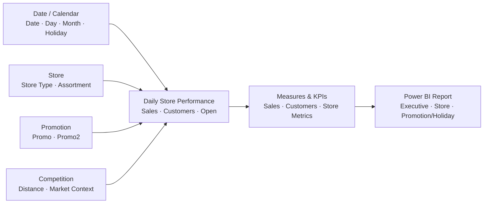

# Rossmann Retail Sales & Promotion Analytics

**Power BI + Python Retail Analytics Portfolio Project**  
**Focus:** retail sales drivers · store performance · promotion effectiveness · customer traffic · holiday analysis · executive reporting

This project analyzes historical **Rossmann retail store performance** to understand the operational factors associated with sales, customer traffic, promotions, store characteristics, holidays, and competitive conditions.

The project combines a Python/Jupyter analytical workflow with a **3-page Power BI dashboard** designed to translate detailed retail data into clear business insights for store and merchandising decisions.

---

## Executive Summary

Retail performance varies across stores because of differences in customer traffic, promotional activity, store type, assortment, calendar patterns, and local competitive conditions.

The objective of this project was to move beyond a simple sales dashboard and answer practical business questions such as:

- Which stores and store characteristics are associated with stronger sales performance?
- How do promotions affect revenue and customer activity?
- How does performance change across holidays and calendar periods?
- Which operational factors should managers monitor when comparing store performance?
- How can Power BI turn a large retail dataset into an executive decision-support tool?

The final deliverable combines exploratory analysis, statistical thinking, and interactive business intelligence to provide a multi-level view of Rossmann's retail performance.

---

## Portfolio Highlights

- Analyzed a large historical retail dataset containing **800K+ records**.
- Built an interactive **Power BI report with 3 analytical pages**.
- Evaluated sales performance alongside **customer traffic, promotions, holidays, store characteristics, assortment, and competition distance**.
- Used Python/Jupyter for analytical exploration and Power BI for executive reporting.
- Created business-facing KPIs and comparative views to identify differences across stores and operating conditions.
- Structured the report around a simplified dimensional analytical model suitable for BI reporting.

---

## Business Questions

The analysis was designed around six key questions:

1. **Sales Performance** — How does revenue change over time and across stores?
2. **Store Performance** — Which store characteristics are associated with stronger or weaker results?
3. **Customer Traffic** — How closely does customer volume track sales performance?
4. **Promotion Effectiveness** — How do promotional periods compare with non-promotional periods?
5. **Holiday Effects** — How do state and school holidays affect retail activity?
6. **Competitive Environment** — Does competition distance appear related to store performance?

---

## Dataset

The project uses historical Rossmann store-level operational and sales data.

Key analytical fields include:

| Area | Example Variables | Business Purpose |
| --- | --- | --- |
| Sales | Sales | Measure store revenue performance |
| Customer Activity | Customers | Evaluate traffic and demand |
| Promotions | Promo, Promo2 | Compare promotional and non-promotional periods |
| Store Profile | Store Type, Assortment | Segment and compare store formats |
| Competition | Competition Distance | Evaluate local competitive conditions |
| Calendar | Date, Day of Week | Identify time-based patterns |
| Holidays | State Holiday, School Holiday | Evaluate seasonal and event-driven effects |
| Operations | Open | Separate operating from non-operating days |

---

## Conceptual Data Model

The diagram below is a simplified analytical representation of the model used for reporting. It is intended to demonstrate BI/data-modeling logic rather than reproduce every field in the Power BI model.



### BI Design Logic

```text
Store / Calendar / Promotion / Competition Attributes
                         │
                         ▼
              Daily Store Performance
              • sales
              • customers
              • store activity
                         │
                         ▼
                 DAX / KPI Layer
                         │
                         ▼
                Power BI Dashboard
```

This structure helps separate descriptive store attributes from the daily performance measures being analyzed.

---

## Analytical Workflow

```text
Business Questions
       │
       ▼
Data Preparation
       │
       ▼
Exploratory Analysis
       │
       ▼
Sales Driver Analysis
       │
       ▼
Store / Promotion / Holiday Comparisons
       │
       ▼
Power BI Data Model & Measures
       │
       ▼
Executive Dashboard
       │
       ▼
Business Insights & Recommendations
```

---

## Power BI Dashboard

The uploaded report contains **three dashboard pages**, each serving a different analytical purpose.

### 1. Executive Overview

The Executive Overview provides a high-level snapshot of retail performance for business users.

The page includes:

- Executive KPI card
- Sales trend visualization
- Comparative column and bar charts
- Distribution / composition view
- 100% stacked comparison
- Interactive slicer
- Page navigation

The objective is to let a stakeholder quickly understand overall performance before drilling into individual stores or operating drivers.

### 2. Store Analysis

The Store Analysis page focuses on differences in performance across locations and store characteristics.

The page includes:

- Store-level KPI card
- Multiple store comparison charts
- Scatter analysis
- Store composition / segmentation view
- Detailed table
- Interactive navigation

This page is intended to help identify high- and low-performing locations and investigate how store characteristics relate to business performance.

### 3. Promotion & Holiday Analysis

The Promotion and Holiday Analysis page evaluates how sales behavior changes under different promotional and calendar conditions.

The page includes:

- Promotion / holiday KPI card
- Stacked area trend analysis
- Gauge visualization
- Comparative bar chart
- Multiple composition charts
- Matrix / pivot-style analysis
- Interactive slicer
- Page navigation

This page supports decisions around promotional timing, holiday planning, staffing, and inventory preparation.

---

## Analytical Areas

### Sales & Customer Performance

Sales were analyzed alongside customer traffic to evaluate whether stronger store performance was primarily associated with greater customer volume or other operational factors.

This type of comparison helps distinguish between:

- traffic-driven growth;
- stronger revenue generation per customer;
- store-format differences;
- time-based changes in demand.

### Promotion Analysis

Promotional periods were compared with non-promotional periods to evaluate how promotion activity corresponds with sales and customer behavior.

The analysis is useful for assessing whether promotional activity appears to generate incremental demand and where deeper ROI analysis would be valuable.

### Store Segmentation

Store type and assortment attributes were used to compare operational performance across different retail formats.

This provides a business-friendly way to identify whether particular store configurations consistently perform differently from others.

### Holiday Analysis

State and school holiday indicators were incorporated into the reporting layer to examine demand changes around calendar events.

This type of analysis can support:

- inventory planning;
- labor scheduling;
- promotion timing;
- seasonal forecasting.

### Competition Analysis

Competition distance provides a proxy for the local competitive environment surrounding a store.

Rather than assuming that closer competition directly causes weaker performance, the variable is used as a comparative factor that can be evaluated alongside store type, customer traffic, promotion status, and other business conditions.

---

## Business Insights

The project highlights several useful retail analytics themes:

- **Customer traffic is a major driver of daily sales**, making traffic and revenue important to analyze together.
- **Promotional periods show meaningful performance differences** and should be evaluated alongside customer response rather than sales alone.
- **Store characteristics matter** when comparing performance across locations.
- **Holiday and calendar effects create demand variation** that can affect inventory and staffing requirements.
- **Competition distance should be interpreted in context**, rather than treated as a standalone explanation of store performance.
- Store-level reporting is more actionable when executives can move from overall KPIs into store, promotion, and holiday views within the same semantic model.

---

## Business Recommendations

Based on the analytical framework, retail managers could use these insights to:

- Compare promotions using both sales and customer response.
- Prioritize deeper investigation of consistently high- and low-performing stores.
- Adjust inventory and staffing plans around recurring calendar and holiday patterns.
- Segment store performance by format and assortment instead of relying only on company-wide averages.
- Incorporate local competitive conditions into store-performance reviews.
- Maintain a common Power BI KPI layer so executives and analysts work from consistent metric definitions.

---

## Technologies & Skills

### Technologies

- Python
- Pandas
- NumPy
- Jupyter Notebook
- Power BI
- DAX
- Power Query
- Git / GitHub

### Skills Demonstrated

- Retail analytics
- Exploratory data analysis
- Data cleaning and transformation
- KPI development
- Dimensional / BI data modeling
- Store-performance analysis
- Promotion analysis
- Holiday / seasonality analysis
- Customer traffic analysis
- Executive dashboard design
- Data visualization
- Business storytelling

---

## Repository Structure

The repository currently contains the core project artifacts:

```text
Rossman-Price-Elasticity-Project/
│
├── Price_Elasticity.ipynb   # Python / Jupyter analysis
├── Rossman Dashboard.pbix   # Interactive Power BI report
└── README.md                # Project case study and documentation
```

---

## What This Project Demonstrates

This project demonstrates my ability to move through the analytics lifecycle from a large operational dataset to an executive-facing BI product:

**Raw Retail Data → Data Preparation → Analytical Investigation → Data Modeling → KPI Development → Power BI Visualization → Business Recommendations**

The value of the project is not only in creating visuals. It shows how store, customer, promotion, holiday, and competitive data can be organized into a reporting framework that helps business users compare performance and investigate the drivers behind it.

---

## Future Enhancements

Potential next steps include:

- Add automated refresh / pipeline orchestration.
- Build a dedicated forecasting layer for future store sales.
- Compare promotion uplift by store segment.
- Add store clustering based on performance and operating characteristics.
- Develop more formal elasticity / response models where appropriate pricing data is available.
- Publish static dashboard screenshots in the repository for faster recruiter review.

---

## Author

**Muzammil Paracha**  
Data Analytics · SQL · Power BI · Databricks · Python · Business Intelligence
